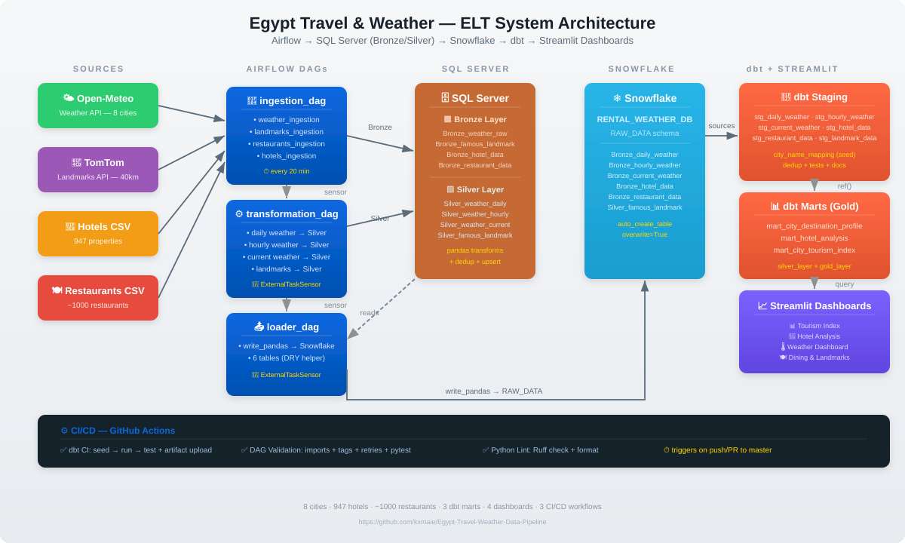
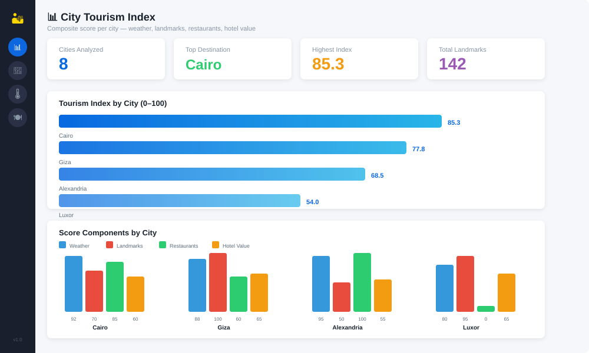
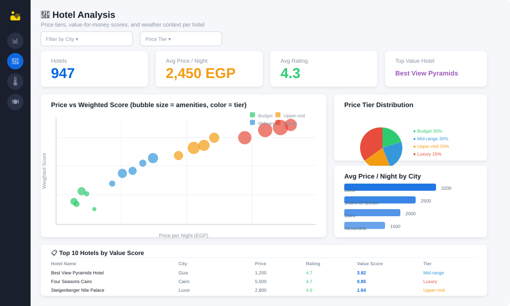
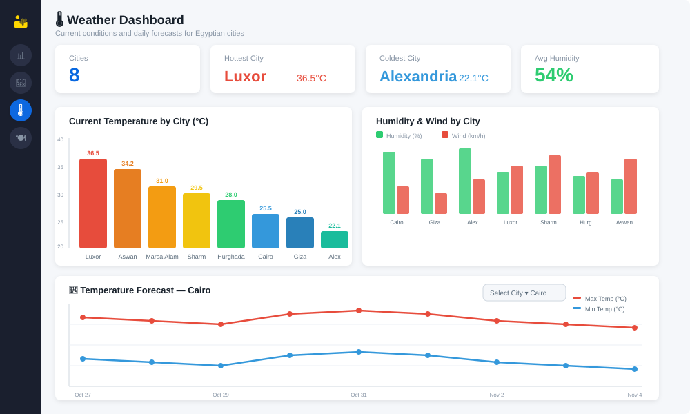
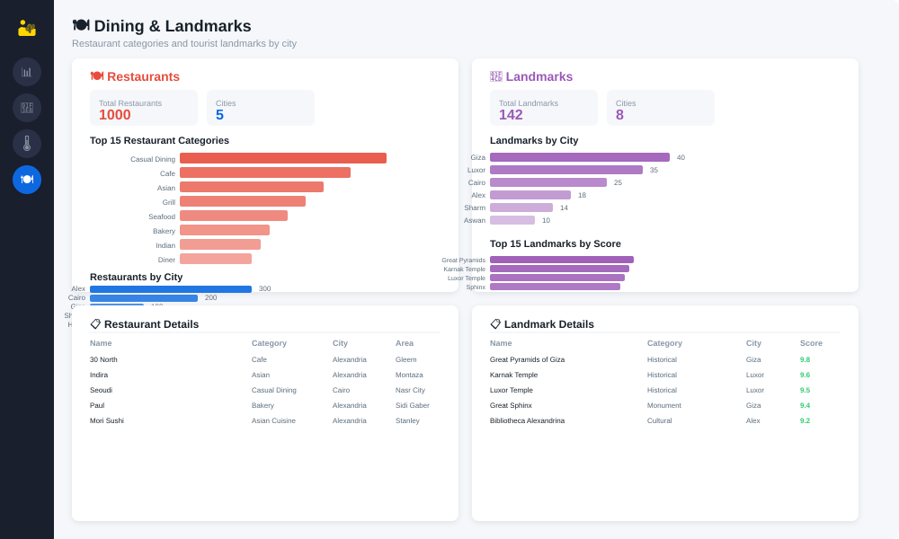

# Weather & travel Data Pipeline

End-to-end ELT built on **Astronomer Airflow**: ingest APIs and CSV files into **Microsoft SQL Server** (bronze/silver), load into **Snowflake**, then model with **dbt** (staging in `silver_layer`, marts in `gold_layer`).

## System Architecture



<details>
<summary>📷 Text version of the architecture</summary>

```
Open-Meteo (weather) ──┐
TomTom (landmarks)  ───┼──► SQL Server (Bronze → Silver) ──► Snowflake RAW_DATA ──► dbt staging ──► dbt marts (gold)
CSV (hotels / restaurants) ─┘
```

</details>

**8 cities** · 947 hotels · ~1000 restaurants · 3 dbt marts · 4 Streamlit dashboards · 4 CI/CD workflows

## Streamlit Dashboard Previews

### 📊 Tourism Index



Composite city scores (0–100) combining weather comfort, landmark count, restaurant category variety, and hotel value — with data coverage shown per city.

### 🏨 Hotel Analysis



Price vs rating scatter (sized by amenities, colored by tier), price tier pie chart, avg price per city, and a top-value hotel ranking table.

### 🌡️ Weather Dashboard



Current temperature bar chart, humidity & wind grouped bars, and a multi-day temperature forecast line chart per city.

### 🍽️ Dining & Landmarks



Restaurant category distribution, landmarks by city, top landmarks by score, and detailed data tables for both.

---

## How It Works

Airflow DAGs (scheduled daily in `Africa/Cairo`, matching the source ingestion guard):

1. **`ingestion_dag`** — weather (Open-Meteo), landmarks (TomTom), restaurants CSV, hotels CSV → Bronze tables in SQL Server. CSV snapshots publish atomically; API errors fail the task so Airflow retries.
2. **`transformation_dag`** — builds silver tables from bronze (Python + pandas), after `ExternalTaskSensor` on ingestion
3. **`loader_dag`** — copies silver/bronze tables to Snowflake with `write_pandas`, after sensor on transformation

`ExternalTaskSensor` uses `execution_delta` to align logical dates between DAGs.

## Repository layout

| Path | Role |
|------|------|
| `dags/` | Airflow DAG definitions (3 DAGs) |
| `include/ingestion/` | API + CSV load into SQL Server (bronze) |
| `include/transformations/` | Bronze → silver transforms (weather + landmarks) |
| `include/loaders/` | SQL Server → Snowflake loader (DRY helper) |
| `include/dbt_project/` | dbt project: staging, marts, tests, seeds |
| `include/*.csv` | Sample static files (paths in DAGs assume Astro `/usr/local/airflow/include/`) |
| `dashboard/` | Streamlit interactive dashboards (4 pages) |
| `assets/` | Architecture diagram + dashboard preview images |
| `INSIGHTS_DASHBOARD.md` | Comprehensive SQL-based insights guide |

## dbt Models

### Staging (silver_layer)
- `stg_daily_weather_data` — daily forecast (deduped by city + date)
- `stg_hourly_weather_data` — hourly weather (deduped by city + timestamp)
- `stg_current_weather_data` — current conditions (one row per city)
- `stg_hotel_data` — hotels with price/rating extraction (deduped by name + coords)
- `stg_restaurant_data` — restaurants (deduped by source id + city)
- `stg_famous_landmark_data` — landmarks with rank within category

### Marts (gold_layer)
- `mart_city_destination_profile` — city-level weather + landmark + restaurant profile (uses city_name_mapping seed)
- `mart_hotel_analysis` — hotel price tiers, value-for-money scores, amenity counts, weather context
- `mart_city_tourism_index` — composite tourism score (0–100) per city with tier label
- The tourism score exposes data coverage and methodology version; relative count/value components are comparable within one build.

### Seeds
- `city_name_mapping` — maps Arabic ↔ English city names for cross-source joins (8 cities)

### Tests
- `models/staging/staging.yml` — not_null tests on key columns
- `models/marts/marts.yml` — not_null + unique on mart grains
- `tests/staging/` — singular SQL dedup assertions (6 tests)
- `tests/marts/` — tourism index range and coverage assertion

## Prerequisites

- [Docker](https://docs.docker.com/get-docker/) and [Astro CLI](https://www.astronomer.io/docs/astro/cli/overview/) for local Airflow
- Reachable **SQL Server** and **Snowflake** accounts
- **dbt** with Snowflake adapter

## Airflow connections

Configure in the Airflow UI or `airflow_settings.yaml` (local):

| Connection ID | Type | Purpose |
|---------------|------|---------|
| `sql_server_conn` | Microsoft SQL Server | Bronze/silver tables |
| `conn_snowflake` | Snowflake | `RENTAL_WEATHER_DB.RAW_DATA` loads |

**TomTom API key**: set Airflow Variable `TOMTOM_API_KEY` or environment variable `AIRFLOW_VAR_TOMTOM_API_KEY`. Never commit real keys. API tasks use request timeouts and fail on non-success HTTP responses so Airflow retries instead of reporting a successful stale run.

## Environment variables (for dbt)

| Variable | Description |
|----------|-------------|
| `SNOWFLAKE_ACCOUNT` | Snowflake account identifier |
| `SNOWFLAKE_DATABASE` | Target database (default: RENTAL_WEATHER_DB) |
| `SNOWFLAKE_PASSWORD` | Snowflake password |
| `SNOWFLAKE_ROLE` | Role (default: WEATHER_PROJECT_ROLE) |
| `SNOWFLAKE_SCHEMA` | Target schema (default: RAW_DATA) |
| `SNOWFLAKE_SOURCE_DATABASE` | Database containing loader source tables (default: RENTAL_WEATHER_DB) |
| `SNOWFLAKE_USER` | User (default: AIRFLOW_USER) |
| `SNOWFLAKE_WAREHOUSE` | Warehouse (default: WEATHER_WH) |
| `AIRFLOW_VAR_TOMTOM_API_KEY` | TomTom Search API key (alternative to the Airflow Variable) |

## Local Airflow

```bash
astro dev start
```

UI: [http://localhost:8080](http://localhost:8080)

## dbt

From the dbt project directory:

```bash
cd include/dbt_project
dbt seed          # loads city_name_mapping.csv
dbt run           # staging (silver_layer) + marts (gold_layer)
dbt test          # staging + mart tests + singular dedup tests
```

- **Profile**: `profiles.yml` uses `env_var()` for all secrets — never commit real credentials.
- **Sources**: `models/sources.yml` → Snowflake `RENTAL_WEATHER_DB.RAW_DATA` by default (`SNOWFLAKE_SOURCE_DATABASE` can override it).
- The tourism index renormalizes component weights when a source is missing and publishes `data_coverage_pct` plus `index_methodology_version`. Landmark, restaurant, and hotel-value scores are relative to the current city cohort, so compare them within the same build.

## Streamlit Dashboards

```bash
cd dashboard
pip install -r requirements.txt
cp .env.example .env   # fill in Snowflake credentials
streamlit run app.py
```

Open [http://localhost:8501](http://localhost:8501) — 4 interactive pages:

| Page | Description |
|------|-------------|
| 📊 Tourism Index | Composite city scores (0–100) with component breakdown |
| 🏨 Hotel Analysis | Price vs rating, price tiers, value-for-money ranking |
| 🌡️ Weather Dashboard | Current conditions + multi-day forecasts |
| 🍽️ Dining & Landmarks | Restaurant categories + landmark scores |

## Insights & Dashboards (SQL)

See [`INSIGHTS_DASHBOARD.md`](INSIGHTS_DASHBOARD.md) for:
- Architecture diagram & data relationships
- City tourism index methodology
- Hotel analysis SQL queries
- Weather × tourism cross-analysis
- Restaurant & landmark breakdowns
- Key insights and data gaps

## CI/CD (GitHub Actions)

Three validation workflows run on pushes / pull requests. A separate Snowflake integration workflow is started manually and uses isolated CI schemas:

| Workflow | Purpose |
|----------|---------|
| **Airflow DAG Validation** | DAG imports, tags, retries ≥ 2, pytest |
| **dbt CI** | Credential-free dbt dependency resolution and project parsing |
| **dbt Snowflake Integration** | Manual `dbt build` against an isolated CI database/schema |
| **Python Lint** | Ruff lint + format on dags, include, dashboard |

See [`.github/workflows/README.md`](.github/workflows/README.md) for setup instructions and required secrets.

## DAG tests (pytest)

`tests/dags/test_dag_example.py` checks DAG tags, retries, and shared daily scheduling. API ingestion tests confirm failures propagate instead of being treated as successful runs.

## License / contact

Update this section for your own use case.
